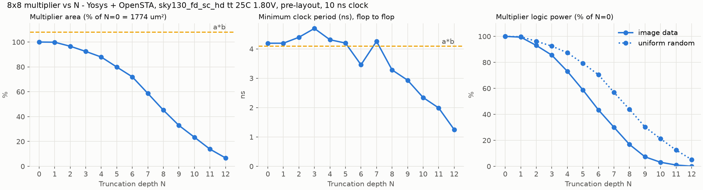
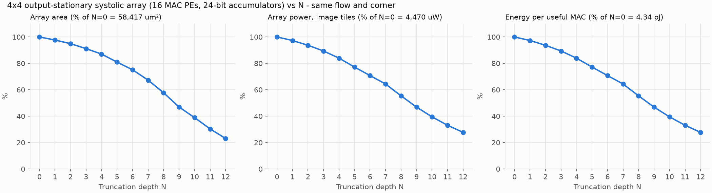
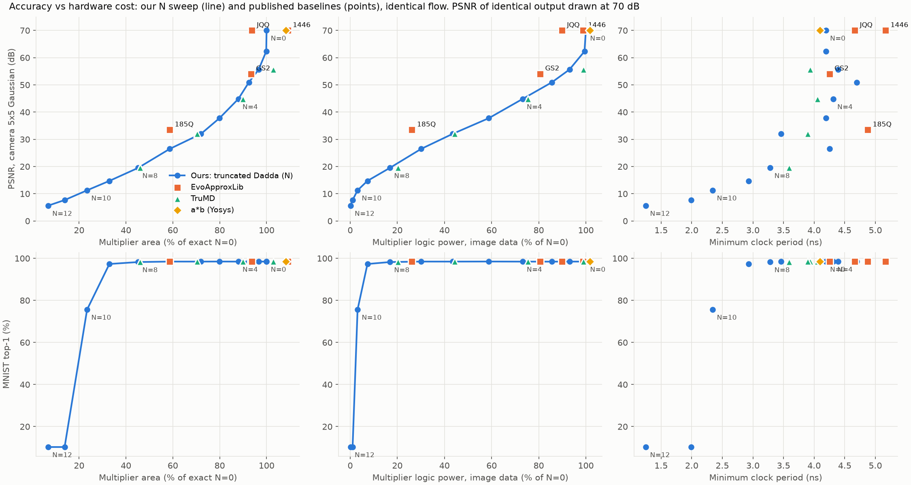
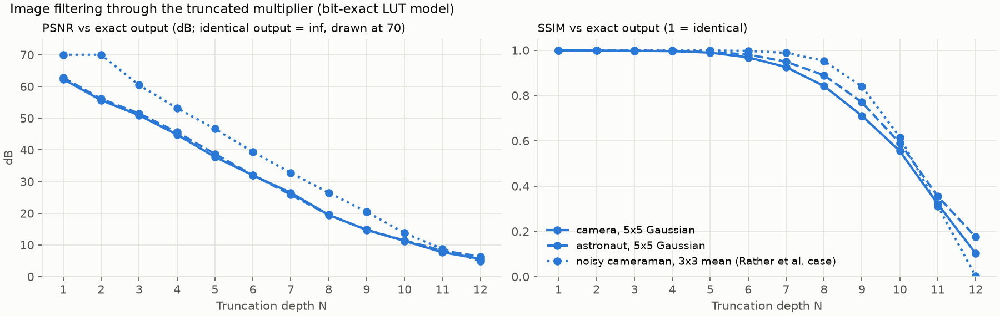
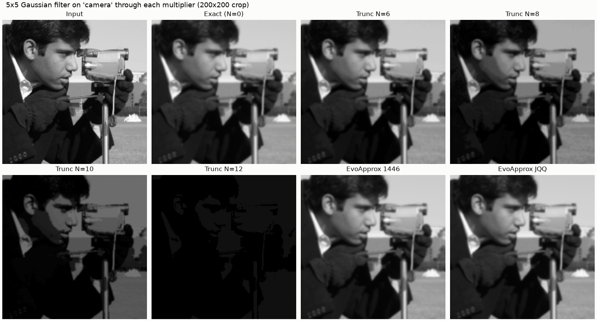
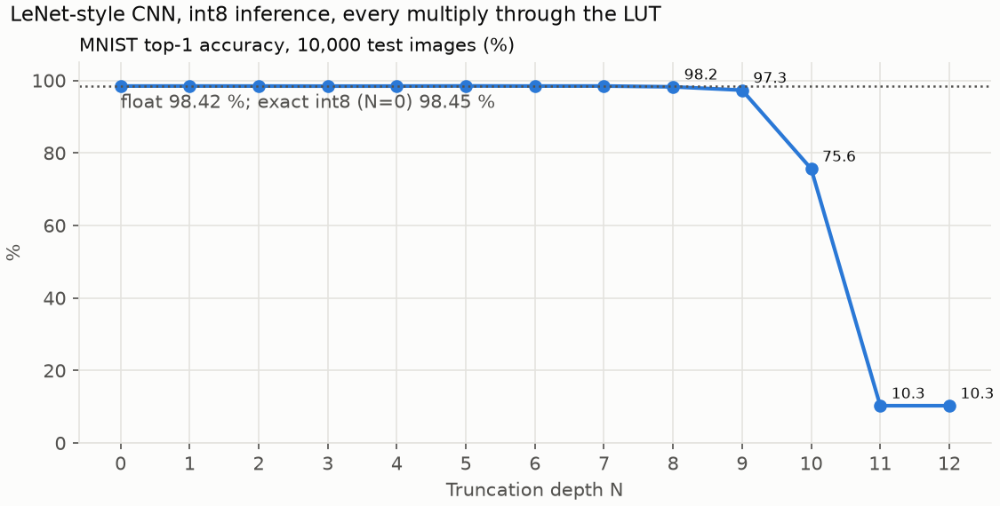
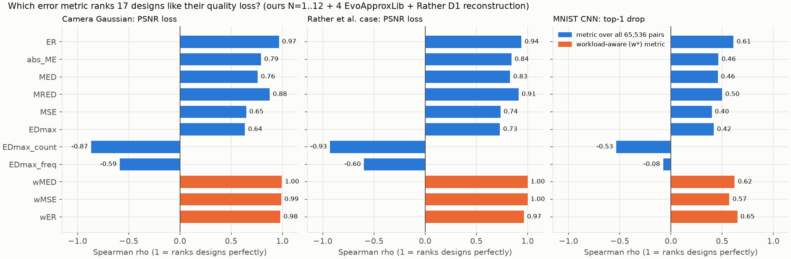

# AxMAC: A Precision-Scalable Approximate MAC Accelerator with Open-Source ASIC Characterization

Final report, Milestone 2 (Oct 29, 2026). AI Accelerators course project, IIIT Dharwad.

Every number in this report comes from a CSV in `results/`, written by a script
in this repository, and was copied from the output of
`python scripts/m2_tables.py` (Milestone 1 numbers: `scripts/md_tables.py`).
Every figure is regenerated by `make figures`. `make all` reproduces
everything from a clean copy. Reference numbers in brackets point to
`docs/REFERENCES.md`.

**Tool flow and corner, stated once for every hardware number below:** Yosys
0.33 (`synth -flatten`, `dfflibmap`, `abc -liberty`), OpenSTA 3.1.0, Icarus
Verilog 12.0, SkyWater SKY130 `sky130_fd_sc_hd__tt_025C_1v80` (typical, 25 °C,
1.80 V), **pre-layout** (no wire parasitics, ideal clock), 10 ns clock for
slacks and power. Hardware results are reported **relative to our exact
multiplier (N = 0)**; we do not compare our absolute numbers with papers that
used other tools or processes.

## 1. Motivation

Inference in a convolutional neural network (CNN) is dominated by
multiply-accumulate (MAC) operations, and the multiplier is the largest and
most power-hungry part of a MAC. Many AI and image workloads tolerate small
arithmetic errors, so an *approximate* multiplier can trade a little accuracy
for less area, power and delay [10, 11]. Published approximate multipliers
usually offer only a few fixed accuracy points, and their error is normally
summarized by metrics averaged over uniformly random inputs (MED, NMED,
EDmax...), which may or may not predict what happens in an application.

This project builds an approximate 8x8 multiplier whose amount of
approximation is one compile-time parameter N, puts it in a MAC unit and a
4x4 systolic array, characterizes all of it with a fully open-source ASIC
flow, evaluates it on image filtering and a small CNN, re-runs published
approximate multipliers through the identical flow, and tests which error
metric best predicts application quality.

**Contribution.** The multiplier architecture, a Dadda tree with truncated
low-order columns, is existing prior art. Our contribution is the
parameterization, the open-flow characterization and the evaluation framework.
In particular:

- One parameter N covers the whole truncation range, so we report a full sweep
  (N = 0..12), where closely related work reports a few design points: Rather
  et al. 2025 [1] has two FPGA designs, and X-Dadda [2] uses approximate width
  as one knob among several. Parameterized approximate multipliers themselves
  are not new: X-Dadda [2] and TPU-Gen [3] both have them.
- The toolchain is fully open (sky130 ASIC flow, not FPGA/Vivado), so every
  number can be independently reproduced.
- Rather et al. [1] observed that image quality tracks EDmax and how often it
  occurs, not just MED/NMED. We test that observation systematically: 17
  designs (our N sweep plus baselines), image and CNN workloads, and a
  rank-correlation analysis.

## 2. Design

### 2.1 Truncated Dadda multiplier (`rtl/approx_mul.sv`)

An 8x8 multiplication forms 64 partial-product bits pp(i, j) = a[j] AND b[i],
each worth 2^(i+j); bits with equal i + j form a *column*. A Dadda tree [5]
adds them in four stages of full and half adders (column-height targets 6, 4,
3, 2; 35 full adders and 7 half adders, planned and self-checked by
`scripts/gen_dadda.py`), leaving two 16-bit rows that a final adder (a
behavioral `+`, mapped by Yosys) adds up.

The approximation: every partial product in the lowest N columns
(i + j < N) is replaced by a constant 0. N = 0 is exact. Dropped bits only
remove value, so the result is never larger than the exact product (errors are
one-sided; mean error ME = -MED). **The tree is not re-planned for each N**:
the same tree is used for every N, and synthesis deletes the adders whose
inputs became constant 0 (constant propagation). That is where the savings
come from.

### 2.2 MAC processing element (`rtl/mac_pe.sv`)

`approx_mul #(N)` followed by a 24-bit accumulator with synchronous `clear`
(start a new sum) and `en` (accumulate; `en = 0` stalls the PE). The PE also
registers its inputs and passes them to its right and lower neighbours, as a
systolic array needs. 24 bits hold at least 2^24 / 65,025 = 258 full-scale
products without overflow; beyond that the accumulator wraps like any
fixed-width adder (tested).

### 2.3 4x4 systolic array (`rtl/systolic_array.sv`)

Output-stationary, built from scratch: PE(i, j) keeps C[i][j] in its
accumulator while A flows left-to-right and B top-to-bottom, so each input
byte is reused 4 times without re-reading memory (the reason accelerators such
as the TPU use systolic arrays [15]). Row i of A and column j of B are delayed
by i and j cycles by internal skew registers, so PE(i, j) sees A[i][k] and
B[k][j] in the same cycle. The caller feeds column k of A and row k of B at
cycle k, for any K, then 6 drain cycles. Every PE uses the same N.

### 2.4 Verification

| what | how | result |
|---|---|---|
| multiplier RTL vs model | all 65,536 pairs, every N = 0..12 (`make test`) | 13/13 PASS |
| model | 42 pytest checks (closed-form MED, N=4 EDmax 49 x 256 pairs, ...) | pass |
| MAC PE | 3,319 random cycles per N incl. clears, stalls and accumulator wrap, vs a Python golden model on the LUT (`make test-mac`) | 13/13 PASS |
| systolic array | 34 tests per N: random matrices K = 1..64, all-255, zeros, K = 256 at full scale, random stalls, and 16 image-patch (im2col) tiles | 13/13 PASS |
| array on real image data (M2.11) | 64 cameraman pixels computed by the RTL array equal `eval/image_conv.py` | match, every N |
| baselines | each RTL vs its own model, all 65,536 pairs (Sec. 5) | 8/8 PASS |
| synthesized netlists | gate-level simulation of every netlist with the sky130 cell models; outputs vs the design's LUT | all 22 multiplier netlists (5,008 products each, both stimuli) and 13 array netlists (800 sums each) match |
| the checkers themselves | comparing an N = 4 dump with the N = 3 model | correctly FAIL |

The last row matters: a checker that cannot fail proves nothing.

## 3. Error of the multiplier


| N | ER (%) | MED | MRED | MSE | EDmax | pairs at EDmax |
|---|---|---|---|---|---|---|
| 1 | 25.0 | 0.25 | 1.79e-04 | 0.25 | 1 | 16384 |
| 2 | 50.0 | 1.25 | 7.75e-04 | 3.75 | 5 | 4096 |
| 4 | 81.2 | 12.25 | 5.64e-03 | 248.2 | 49 | 256 |
| 6 | 93.8 | 80.25 | 2.64e-02 | 9158 | 321 | 16 |
| 8 | 98.0 | 448.25 | 9.78e-02 | 2.633e+05 | 1793 | 1 |
| 10 | 99.0 | 1664.25 | 2.55e-01 | 3.672e+06 | 6657 | 1 |
| 12 | 99.2 | 4992.25 | 5.30e-01 | 3.527e+07 | 19969 | 1 |

Every metric grows with N. MED follows the closed form
MED(N) = 0.25 x (sum of 2^(i+j) over i + j < N) exactly. EDmax is hit when
every dropped bit is 1, so it is hit by fewer pairs as N grows (16,384 pairs at
N = 1, one pair from N = 8).

## 4. Hardware results

### 4.1 Multiplier vs N



Multiplier inside `rtl/mul_wrap.sv` (flip-flops on inputs and outputs so it
can be timed flop to flop). "Logic power" is the multiplier's combinational
cells; image stimulus = (pixel, filter weight) pairs from the 5x5 Gaussian
filter on the cameraman image, in the order one PE consumes them; random =
uniform 8-bit inputs. 5,000 cycles each.

| design | area (um²) | area vs N=0 | min period (ns) | logic power, image (uW) | vs N=0 | logic power, random (uW) | vs N=0 |
|---|---|---|---|---|---|---|---|
| N0 | 1774 | +0.0% | 4.19 | 82.8 | +0.0% | 169.2 | +0.0% |
| N2 | 1714 | -3.4% | 4.39 | 77.0 | -6.9% | 162.9 | -3.8% |
| N4 | 1560 | -12.1% | 4.31 | 60.5 | -26.9% | 147.9 | -12.6% |
| N6 | 1277 | -28.0% | 3.46 | 36.0 | -56.5% | 119.3 | -29.5% |
| N7 | 1041 | -41.3% | 4.26 | 24.9 | -69.9% | 96.3 | -43.1% |
| N8 | 802 | -54.8% | 3.28 | 13.9 | -83.2% | 74.2 | -56.1% |
| N9 | 584 | -67.1% | 2.93 | 6.1 | -92.7% | 51.2 | -69.7% |
| N10 | 415 | -76.6% | 2.34 | 2.6 | -96.9% | 36.0 | -78.7% |
| N12 | 120 | -93.2% | 1.25 | 0.1 | -99.9% | 8.8 | -94.8% |
| a*b (Yosys) | 1919 | +8.2% | 4.09 | 84.3 | +1.8% | 179.1 | +5.8% |

Observations:

- **Area and power fall steadily with N**, slowly at first (the low columns
  hold few bits) and fast from N = 6 (the middle columns are the tallest).
- **Power saving is larger with image data than with random data** at the same
  N (-83.2 % vs -56.1 % at N = 8). Filter weights are small numbers, so the
  upper bits of b rarely toggle; the remaining activity sits in the low columns
  that truncation removes. Power depends on the data, which is why Milestone 2
  measures it with workload data.
- **Delay is not monotonic in N** (4.19 ns at N = 0, 4.69 ns at N = 3, 3.46 ns
  at N = 6, 4.26 ns at N = 7). Truncation removes the shortest, low-order paths
  first, and the critical path runs through the high columns and the final
  carry-propagate adder, which barely change until N is large. On top of that,
  ABC maps for area, so small changes in the netlist can move the critical path
  by a few tenths of a nanosecond. Delay falls clearly only from N = 8. We report
  the numbers as measured rather than smoothing them.
- Our exact tree is 7.6 % smaller than letting Yosys build `a*b` (1774 vs
  1919 um²) at a similar delay, so N = 0 is a reasonable exact reference.

### 4.2 The 4x4 systolic array vs N



Synthesized as a whole (16 PEs, skew registers, 24-bit accumulators). Power
from a gate-level simulation of 50 image tiles (4 neighbouring 5x5 cameraman
patches x 4 filters each; 1,942 cycles including the clear and drain cycles
every tile needs). Energy per MAC = power x 10 ns / useful MACs per cycle; the
array achieved 10.3 useful MACs per cycle out of 16 (64 %), because each
25-tap tile spends 8 cycles clearing and 6 draining.

| N | area (um²) | area vs N=0 | logic / flops (um²) | flops | min period (ns) | power, image (uW) | power vs N=0 | energy/MAC (pJ) |
|---|---|---|---|---|---|---|---|---|
| 0 | 58,417 | +0.0% | 44,964 / 13,453 | 672 | 5.46 | 4,470 | +0.0% | 4.340 |
| 2 | 55,457 | -5.1% | 42,645 / 12,812 | 640 | 5.18 | 4,188 | -6.3% | 4.067 |
| 4 | 50,851 | -13.0% | 38,680 / 12,172 | 608 | 6.29 | 3,752 | -16.1% | 3.643 |
| 6 | 43,901 | -24.8% | 32,370 / 11,531 | 576 | 5.82 | 3,163 | -29.2% | 3.071 |
| 8 | 33,745 | -42.2% | 23,575 / 10,170 | 508 | 5.12 | 2,477 | -44.6% | 2.405 |
| 10 | 22,719 | -61.1% | 14,632 / 8,088 | 404 | 3.87 | 1,764 | -60.5% | 1.713 |
| 12 | 13,478 | -76.9% | 7,472 / 6,006 | 300 | 3.02 | 1,239 | -72.3% | 1.203 |

The array saves a smaller *fraction* than the bare multiplier (at N = 8:
area -42.2 % vs -54.8 %, power -44.6 % vs -83.2 %) because the accumulators,
the skew and pass-through registers and the clock load do not shrink as much.
They do shrink somewhat: product bits that are always 0 make the low
accumulator bits constant, and synthesis removes those flip-flops (672 at
N = 0, 508 at N = 8). The array's critical path is the multiplier plus the
24-bit accumulator adder (5.46 ns at N = 0, 183 MHz).

## 5. Baselines

Four EvoApproxLib designs [12, 13] (MIT licence, files copied unchanged) and
TruMD (truncated Dadda, 2/4/6/8 columns; fetched at a pinned commit because the
repository has no licence). Each is wrapped to our interface and verified on
all 65,536 pairs against its own model: EvoApproxLib against the library's C
model, TruMD against its description "k lowest columns truncated". All 8 pass.
**TruMD trunc-k computes exactly the same function as our N = k**, built as a
different circuit (4:2 compressors), so it is a useful hardware baseline and
an independent cross-check of our model, but it is left out of the metric
analysis (it would count four designs twice). We also add a software-only
reconstruction of Rather et al.'s Design 1, N = 4 truncation plus a constant
+12, which reproduces the EDmax = 37 for 256 pairs they report; this is a
sanity check, not a claim that it is their circuit.

| design | MED | EDmax (pairs) | ER (%) | area vs N=0 | logic power, image, vs N=0 | camera PSNR (dB) | CNN top-1 change (pp) |
|---|---|---|---|---|---|---|---|
| evo_1446 | 12.0 | 192 (2048) | 9.4 | +9.0% | -1.2% | identical | +0.01 |
| ours N4 | 12.25 | 49 (256) | 81.2 | -12.1% | -26.9% | 44.8 | -0.01 |
| trumd_4 | 12.25 | 49 (256) | 81.2 | -10.2% | -24.6% | 44.8 | -0.01 |
| evo_GS2 | 37.0 | 748 (16) | 29.9 | -6.6% | -19.4% | 54.1 | -0.01 |
| ours N5 | 32.25 | 129 (64) | 89.1 | -20.1% | -41.2% | 37.8 | +0.03 |
| evo_185Q | 118.7 | 518 (4) | 98.0 | -41.3% | -73.8% | 33.5 | +0.06 |
| ours N7 | 192.25 | 769 (4) | 96.5 | -41.3% | -69.9% | 26.5 | +0.01 |
| evo_JQQ | 731.4 | 10176 (32) | 19.8 | -6.3% | -10.2% | identical | +0.03 |
| ours N9 | 896.25 | 3585 (1) | 98.7 | -67.1% | -92.7% | 14.7 | -1.14 |



What the identical flow shows:

- **TruMD vs ours (same function):** within a few percent in area (trumd_4
  1594 vs 1560 um², trumd_6 1250 vs 1277, trumd_8 816 vs 802, trumd_2 1827 vs
  1714) and power. The circuit style matters little once synthesis has
  re-optimized it; the truncation depth is what counts.
- **evo_185Q is better than our curve at its operating point:** the same area
  as our N = 7 (-41.3 %), slightly lower logic power (-73.8 % vs -69.9 %) and a
  higher camera PSNR (33.5 vs 26.5 dB). Truncation is simple and fully
  parameterizable, but it is not Pareto-optimal everywhere.
- **evo_1446 and evo_JQQ cost almost as much as an exact multiplier** in this
  flow (+9.0 % and -6.3 % area); they were optimized by their authors for a
  different library (45 nm), and their savings do not carry over after Yosys
  and ABC re-map them to sky130. Their images are **bit-identical to the exact
  output**: evo_1446 makes no error at all when the weight operand b < 96, and
  evo_JQQ none when b < 48; every Gaussian and averaging weight here is at most
  41. Their error lives where these workloads never go.

## 6. Application accuracy

### 6.1 Image filtering (`eval/image_conv.py`)

Every multiply goes through the design's LUT: output = (sum of
LUT[pixel, weight]) >> 8, weights quantized to unsigned 8-bit and summing to
about 256. PSNR and SSIM [18] are measured against the same pipeline run with
the exact multiplier. Workloads: 512x512 camera and astronaut (gray) with a 5x5
Gaussian (sigma 1); and the case from Rather et al. [1]: 256x256 cameraman,
Gaussian noise of variance 0.01, 3x3 averaging filter.




| N | camera PSNR (dB) / SSIM | astronaut PSNR / SSIM | Rather et al. case PSNR / SSIM |
|---|---|---|---|
| 2 | 55.6 / 0.9984 | 56.1 / 0.9990 | identical |
| 4 | 44.8 / 0.9960 | 45.6 / 0.9974 | 53.2 / 0.9990 |
| 5 | 37.8 / 0.9893 | 38.7 / 0.9932 | 46.6 / 0.9989 |
| 6 | 32.0 / 0.9683 | 32.1 / 0.9806 | 39.4 / 0.9969 |
| 8 | 19.5 / 0.8418 | 19.5 / 0.8895 | 26.5 / 0.9529 |
| 10 | 11.3 / 0.5546 | 11.4 / 0.5899 | 13.8 / 0.6158 |

Up to N = 5 the outputs are visually indistinguishable (PSNR above 37 dB, SSIM
at least 0.989). Beyond that the images get visibly **darker**: truncation
always rounds down, the 25 errors of a 5x5 window add up with the same sign,
and the result is a brightness bias rather than noise. In the Rather et al.
case, N = 1 and 2 give bit-identical output, because the averaging weight
28 = 0b11100 has its two lowest bits at 0, so the dropped partial products
were 0 anyway.

### 6.2 CNN (`eval/cnn.py`)

LeNet-style network [20] (2 conv + 2 FC), trained in float on MNIST, then
post-training quantization [19]: uint8 activations, symmetric int8 per-layer
weights, int32 biases. Integer inference in numpy with
product = sign(w) x LUT[activation, |w|], exact integer accumulation, then
requantization. Float network: 98.42 %; exact int8 (N = 0): 98.45 %.



| N | 0 to 7 | 8 | 9 | 10 | 11, 12 |
|---|---|---|---|---|---|
| top-1 (%) | 98.43 to 98.48 | 98.23 | 97.31 | 75.64 | 10.28 |
| change vs exact int8 (pp) | -0.02 to +0.03 | -0.22 | -1.14 | -22.81 | -88.17 |

The CNN is far more tolerant than the image metrics suggest: N = 7 costs no
accuracy, and N = 8 (multiplier area -54.8 %, logic power -83.2 %, array
energy per MAC -44.6 %) costs 0.22 percentage points. At N = 11 the network
predicts the digit 7 for every image (7s are 10.28 % of the test set). Every EvoApproxLib design stays within
0.06 pp. MNIST is an easy task; a harder one (e.g. CIFAR-10) would likely be
less tolerant.

## 7. Which error metric predicts application quality?

Pool: our N = 1..12, the four EvoApproxLib designs and the Rather Design 1
reconstruction (17 designs; the exact N = 0 and TruMD left out). For each
uniform-input error metric and each quality loss (PSNR loss = -PSNR,
SSIM loss = 1 - SSIM, CNN top-1 drop) we compute the Spearman rank
correlation rho (+1 = the metric orders the designs exactly like the quality
loss). EDmax_freq = EDmax x (pairs at EDmax) / 65,536 combines "EDmax and how
often it occurs" into one number.



| metric | camera PSNR loss | camera SSIM loss | astronaut PSNR loss | Rather case PSNR loss | CNN top-1 drop |
|---|---|---|---|---|---|
| ER | +0.97 | +0.97 | +0.97 | +0.94 | +0.61 |
| MED | +0.76 | +0.76 | +0.76 | +0.83 | +0.46 |
| MRED | +0.88 | +0.88 | +0.88 | +0.91 | +0.50 |
| MSE | +0.65 | +0.65 | +0.65 | +0.74 | +0.40 |
| EDmax | +0.64 | +0.64 | +0.64 | +0.73 | +0.42 |
| EDmax_count | -0.87 | -0.87 | -0.87 | -0.93 | -0.53 |
| EDmax_freq | -0.59 | -0.59 | -0.59 | -0.60 | -0.08 |
| wMED (workload-aware) | +1.00 | +1.00 | +1.00 | +1.00 | +0.62 |
| wMSE (workload-aware) | +0.99 | +0.99 | +0.99 | +1.00 | +0.57 |

(Full table, including SSIM for all workloads and p-values:
`results/metric_correlation.csv`.)

Findings:

1. **For image smoothing, error rate (ER) ranks the designs best** among the
   standard metrics (rho 0.94 to 0.99); MED/NMED is clearly weaker (0.76 to 0.83)
   and EDmax weaker still (0.64 to 0.73).
2. **"EDmax and how often it occurs" does not rank the designs in our pool**:
   EDmax_count and EDmax_freq are *negatively* correlated with quality loss. In
   truncation, a larger N gives a larger EDmax hit by *fewer* pairs, so the
   count falls while quality falls. The matched pairs in Sec. 5 show the same:
   evo_1446 has 4x the EDmax of our N = 4 at equal MED, yet a perfect image.
   This does not refute Rather et al.: their observation concerns sharpening
   and edge detection with specific design pairs, and for smoothing they
   themselves found the lowest-MED design best [1]. We tested smoothing only
   (sharpening/edge detection with signed kernels were optional and not done).
3. **What actually predicts quality is the error on the inputs the workload
   uses.** The image workloads use only 0.4 to 2.3 % of the 65,536 (a, b) pairs
   (the CNN 45.3 %). Weighting MED by how often each pair occurs (wMED) ranks
   the image designs almost perfectly (rho >= 0.99). The two "identical image"
   EvoApproxLib designs are the clearest case: zero error on the pairs used.
   Uniform-input metrics are therefore only a proxy; the operand distribution
   of the target workload should be part of choosing an approximate multiplier.
4. **The CNN result is weak for every metric** (rho at most 0.65): for 12 of
   the 17 designs (N = 1..7, all four EvoApproxLib designs and the
   reconstruction) the top-1 change is within ±0.06 pp, which is noise at
   10,000 test images, so their ranks carry little information.

Caveats: 17 designs, 12 of them from one family whose metrics all rise
together with N; p-values (in the CSV) are only indicative; one network,
one dataset, smoothing filters only.

## 8. Comparison with Rather et al. 2025 [1]

- **Setup.** Our "Rather case" follows their smoothing experiment: 256x256
  cameraman, Gaussian noise of variance 0.01, 3x3 averaging filter, PSNR
  against the exact multiplier's output. Their PSNR values are given only in
  figures, which we do not reproduce or transcribe; we therefore compare
  setups and error statistics, not PSNR numbers.
- **Error statistics.** They report EDmax 37 (256 pairs) for Design 1 and 62
  (64 pairs) for Design 2. Plain truncation at N = 4 gives EDmax 49 for 256
  pairs; adding a constant +12 gives 37 for 256 pairs, matching Design 1. On
  their smoothing case that reconstruction reaches 58.6 dB (SSIM 0.9996), vs
  53.2 dB for plain N = 4: the correction constant cancels most of the
  brightness bias (ME -0.25 instead of -12.25).
- **Hardware.** They use a Xilinx Artix-7 FPGA and Vivado 2022.2 [1]; we use an
  open sky130 ASIC flow. The numbers are not comparable, and we do not compare
  them.

## 9. Limitations

- Pre-layout: no wire capacitance or clock tree; one corner (tt, 25 °C,
  1.80 V). Place-and-route (optional task M2.15) was not done.
- Delay comes from area-oriented ABC mapping and is not monotonic in N (Sec. 4.1).
- Power comes from functional gate-level simulation of the sky130 cell models
  (unit delay), so glitch power is not modelled accurately. The array power
  uses 1,942 cycles (the gate-level simulation of the 6,800-cell array is slow);
  the multiplier uses 5,000.
- The Dadda tree is not re-planned for each N; a tree planned for the
  truncated column heights might be slightly smaller.
- Baselines from EvoApproxLib were optimized for another library and lose much
  of their advantage after re-synthesis; we compare them as re-synthesized.
- Asymmetric designs (EvoApproxLib) depend on which operand goes to which port;
  we always put the activation on `a` and the weight on `b`.
- The CNN is small and MNIST is easy; requantization uses a floating-point
  scale (identical for all designs). The CNN differences below about 0.1 pp are
  noise.
- Only smoothing filters; sharpening and edge detection (signed kernels) were
  optional and not done.

## 10. Prior work

Dadda [5] and Wallace [6] trees are the classic fast multipliers; truncated
multiplication with a correction constant goes back to Schulte and
Swartzlander [7], and the formula for a truncated multiplier we follow appears
in [8]. Error metrics (ED, MED, NMED, MRED) are defined in [9] and surveyed in
[10, 11]. EvoApproxLib [12, 13] provides evolved approximate circuits with
guaranteed error bounds [14]. Closest to this project: Rather et al. [1]
(approximate Dadda multipliers on FPGA, image processing), X-Dadda [2]
(accuracy-configurable Dadda multipliers), TPU-Gen [3] (generated accelerators
with parameterized approximate multipliers) and APTPU [4] (approximate TPU).
Systolic arrays for inference follow the TPU [15]. LUT-based emulation of
approximate DNNs is used by AdaPT [16] and TFApprox [17]; quantization follows
[19]; SSIM is from [18]; LeNet and MNIST from [20]. Tools: Yosys, OpenSTA and
the SkyWater SKY130 PDK [22], versions in `results/tool_versions.txt`.

## 11. Reproducing

```bash
make venv venv-cnn   # Python environment (+ CPU PyTorch for the CNN)
make all             # test, test-mac, metrics, synth, power, sweep, array, report,
                     # baselines, eval, cnn, analysis, figures (about 20 minutes on a 16-core laptop)
```

Individual steps and what each writes are listed in `README.md`;
`docs/project_guide.md` explains every step in detail.
